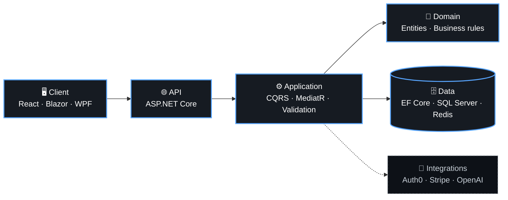

<!-- ═════════════════════════════ HEADER ═════════════════════════════ -->

<div align="center">
  
</div>

<div align="center">
  
</div>

<br/>

<div align="center">
  
</div>

<br/>

<!-- ═════════════════════════════ ABOUT ME ═════════════════════════════ -->

<div align="center">
  
  <br/><br/>
  
</div>

```csharp
public class Hamza : Developer
{
    public string Role => "Full Stack .NET Engineer";
    public string Location => "Multan, Pakistan";
    public int Experience => 3;

    public string[] Stack =>
    [
        "C#", ".NET", "ASP.NET Core", "Blazor", "WPF",
        "React", "EF Core", "SQL Server", "Azure", "Docker"
    ];

    public string[] Builds =>
    [
        "SaaS platforms", "REST APIs",
        "Desktop apps (WPF)", "User Interfaces"
        "Custom Solutions", "Backend Systems"
    ];

    public string[] CurrentlyExploring => 
    [ "RAG", "Vector DB",
      "AI voice agents", "VoIP" 
    ];

    public bool OpenToWork => true;
    public string SayHi() => "mhamzazafarg@gmail.com";
}
```

<!-- ═════════════════════════════ METRICS ═════════════════════════════ -->

<div align="center">
  
  <br/><br/>
  
</div>

<div align="center">

| <h2>10+</h2> | <h2>35%</h2> | <h2>4+</h2> | <h2>3+ yrs</h2> |
| :---: | :---: | :---: | :---: |
| 🚀 Production systems | ⚡ API latency reduced | 🔌 API integrations | 🧑‍💻 .NET experience |

</div>

<!-- ═════════════════════════════ SYSTEM DESIGN ═════════════════════════════ -->

<div align="center">
  
  <br/><br/>
  
</div>



<div align="center">
  <sub><b>Clean Code</b> · <b>Separation of Concerns</b> · <b>Testability</b> · <b>CI/CD</b></sub>
</div>

<br/>

<!-- ═════════════════════════════ TECH STACK ═════════════════════════════ -->

<div align="center">
  
  <br/><br/>
  
</div>

<table align="center" border="0" cellpadding="5" cellspacing="0" style="border-collapse: collapse; border: none;">
  <tr style="border: none;">
    <td align="right" valign="middle" width="120" style="border: none; padding-right: 15px;"><strong>Languages</strong></td>
    <td align="left" valign="middle" style="border: none;">
      
      
      
      
      
      
    </td>
  </tr>
  <tr style="border: none;">
  <td align="right" valign="middle" style="border: none; padding-right: 15px;"><strong>Frameworks</strong></td>
  <td align="left" valign="middle" style="border: none;">
    
    
    
    
    
    
    
    
    
  </td>
</tr>
  <tr style="border: none;">
    <td align="right" valign="middle" style="border: none; padding-right: 15px;"><strong>Architecture</strong></td>
    <td align="left" valign="middle" style="border: none;">
      
      
      
      
    </td>
  </tr>
  <tr style="border: none;">
    <td align="right" valign="middle" style="border: none; padding-right: 15px;"><strong>Databases</strong></td>
    <td align="left" valign="middle" style="border: none;">
      
      
      
      
      
      
    </td>
  </tr>
  <tr style="border: none;">
    <td align="right" valign="middle" style="border: none; padding-right: 15px;"><strong>Cloud</strong></td>
    <td align="left" valign="middle" style="border: none;">
      
      
      
      
    </td>
  </tr>
  <tr style="border: none;">
    <td align="right" valign="middle" style="border: none; padding-right: 15px;"><strong>Security</strong></td>
    <td align="left" valign="middle" style="border: none;">
      
      
      
      
    </td>
  </tr>
  <tr style="border: none;">
    <td align="right" valign="middle" style="border: none; padding-right: 15px;"><strong>DevOps</strong></td>
    <td align="left" valign="middle" style="border: none;">
      
      
      
      
    </td>
  </tr>
  <tr style="border: none;">
    <td align="right" valign="middle" style="border: none; padding-right: 15px;"><strong>Testing</strong></td>
    <td align="left" valign="middle" style="border: none;">
      
      
      
      
    </td>
  </tr>
</table>

<!-- ═════════════════════════════ GITHUB STATS ═════════════════════════════ -->

<div align="center">
  
  <br/><br/>
  
</div>

<div align="center">
  
  
</div>

<br/>

<p align="center">
  <picture>
    <source media="(prefers-color-scheme: dark)" srcset="https://raw.githubusercontent.com/HamzaCodeBase/HamzaCodeBase/output/snake-dark.svg" />
    <source media="(prefers-color-scheme: light)" srcset="https://raw.githubusercontent.com/HamzaCodeBase/HamzaCodeBase/output/snake-light.svg" />
    
  </picture>
</p>

<!-- ═════════════════════════════ CERTIFICATES ═════════════════════════════ -->

<div align="center">
  
  <br/><br/>
  
</div>

<p align="center">
  <a href="https://www.linkedin.com/learning/certificates/93962d6bfee9fc64797ea38d1d4bc9a1af93859d01c8d4a4646d72e3d0f59ad5?trk=share_certificate">
    
  </a>
  <a href="https://www.linkedin.com/learning/certificates/9a2397cacb581351294c7468f0392f3a2fb451f3a8a344db8b2d25d4e23b2f91?trk=share_certificate">
    
  </a>
  <a href="https://www.freecodecamp.org/certification/muhammad-hamza-zafar/foundational-c-sharp-with-microsoft">
    
  </a>
</p>

<!-- ═════════════════════════════ DEV QUOTE ═════════════════════════════ -->

<div align="center">
  
  <br/><br/>
  
  <br/>
  
</div>

<!-- ═════════════════════════════ CONNECT ═════════════════════════════ -->

<div align="center">
  <br/>
  
  <br/><br/>
  
</div>

<p align="center">
  ⭐ Explore my <a href="https://github.com/HamzaCodeBase?tab=repositories"><b>repositories</b></a> &nbsp;·&nbsp;
  👀 <b>Follow</b> for new projects &nbsp;·&nbsp;
  🤝 Reach out to <b>collaborate</b>
</p>

<div align="center">
  <a href="https://linkedin.com/in/hamzazafarg"></a>
  <a href="mailto:mhamzazafarg@gmail.com"></a>
  <a href="https://hamza.is-a.dev"></a>
</div>

<br/>

<div align="center">
  
  <br/>
  <sub>📍 Multan, Pakistan &nbsp;|&nbsp; Open for projects</sub>
</div>

<!-- ═════════════════════════════ FOOTER ═════════════════════════════ -->


